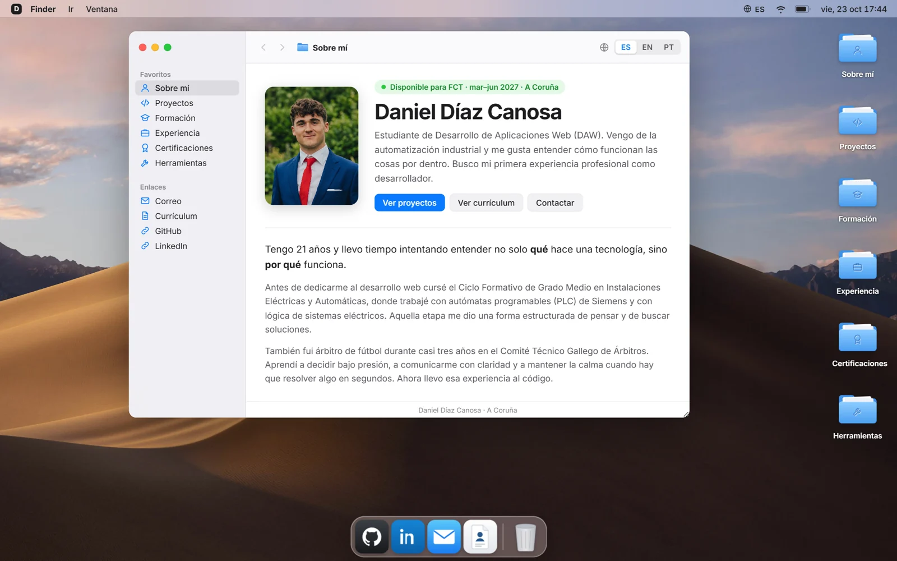
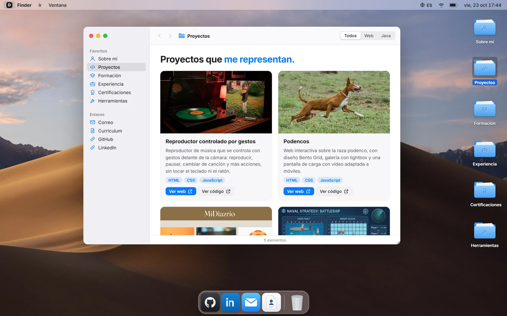
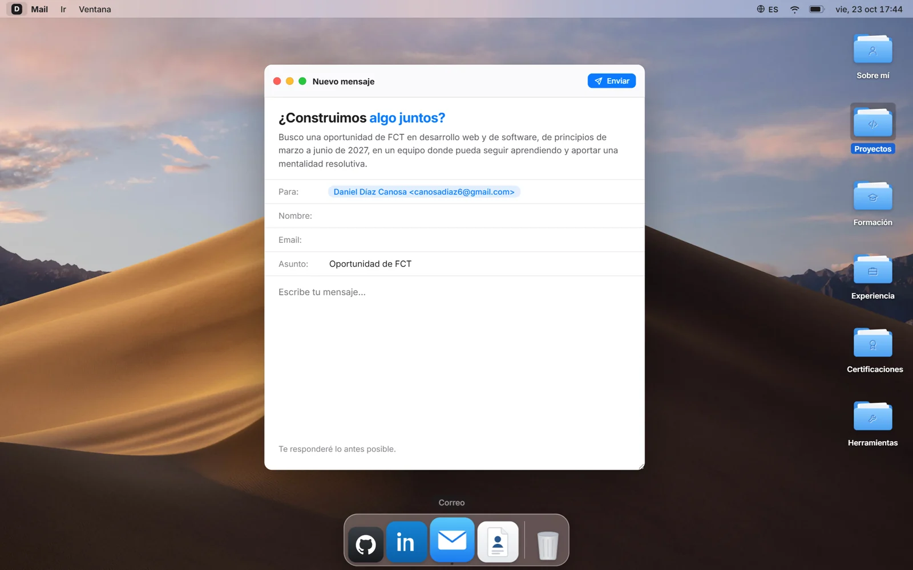
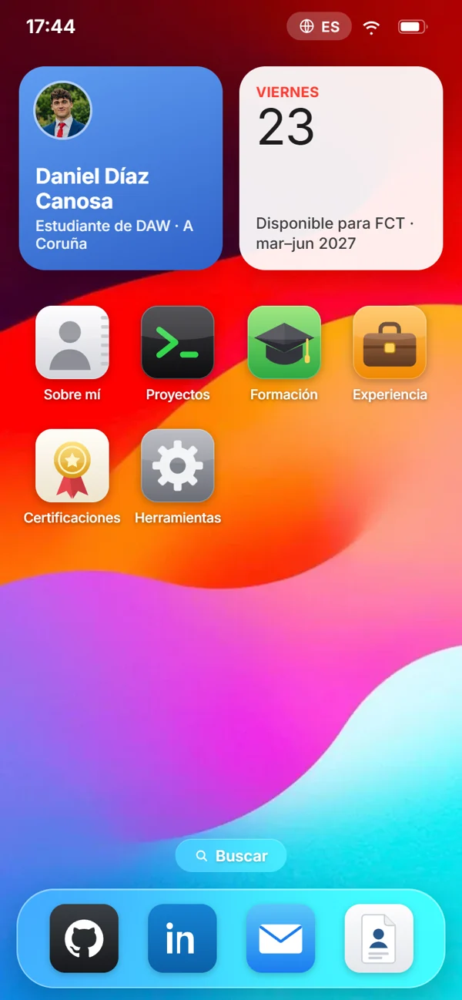
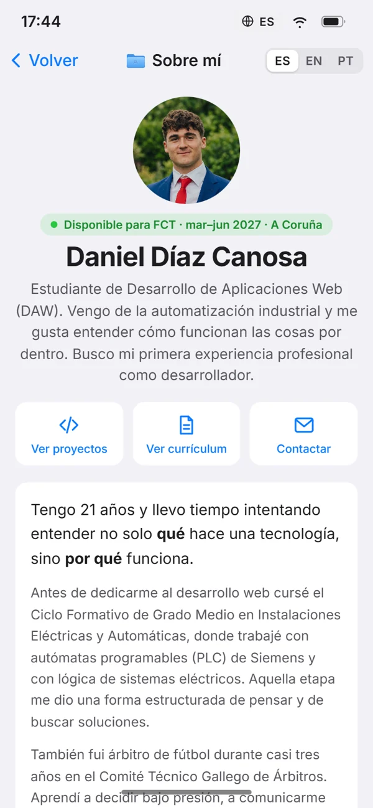
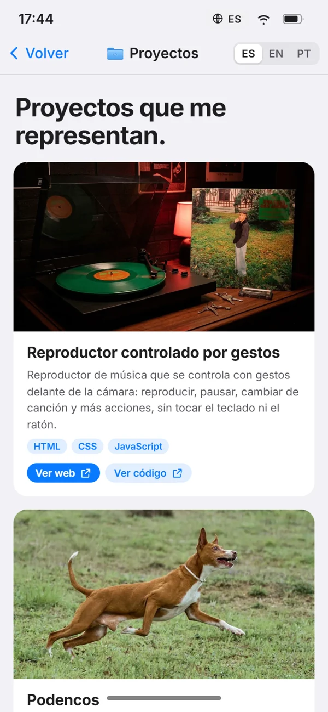
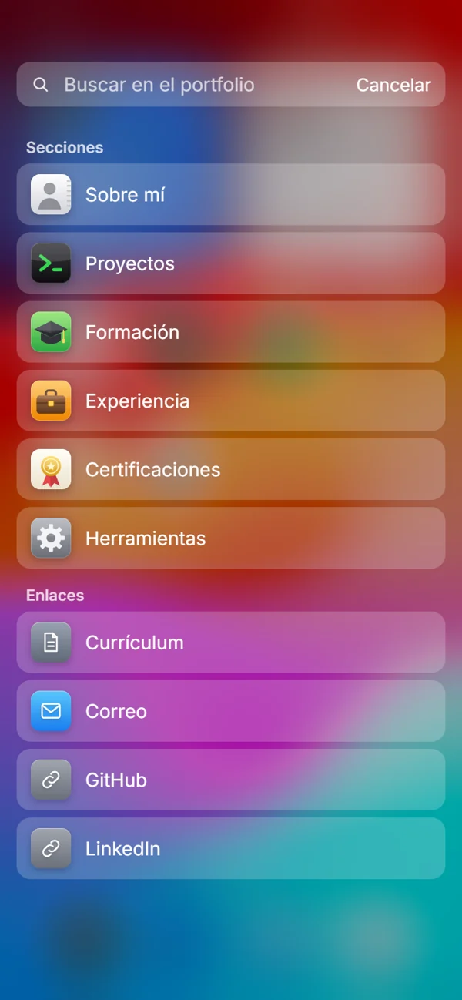

<div align="center">

# portfolioMac

**El portfolio de Daniel Díaz Canosa, hecho a imagen de un Mac en el ordenador y de un iPhone en el móvil.**


<br>



</div>

<br>

## De qué va

En lugar de una página con secciones, el portfolio es un **escritorio**. Cada apartado es una carpeta que se abre como una ventana de Finder, y los accesos rápidos (GitHub, LinkedIn, contacto y currículum) viven en el dock. En el móvil se transforma en la **pantalla de inicio de un iPhone**: widgets, iconos de app y una app por cada sección.

| | Ordenador | Móvil |
|---|---|---|
| **Aspecto** | Escritorio de macOS con barra de menú y dock | Pantalla de inicio de iOS con widgets y búsqueda |
| **Secciones** | Carpetas en el escritorio | Iconos de app |
| **Al abrir una sección** | Ventana de Finder, arrastrable y redimensionable | App a pantalla completa que crece desde su icono |
| **Sobre mí** | Ventana con la presentación | Una sola página larga que recorre todas las secciones |

## Capturas

<table>
  <tr>
    <td width="50%"></td>
    <td width="50%"></td>
  </tr>
  <tr>
    <td align="center"><sub>Proyectos, con filtro Todos, Web y Java</sub></td>
    <td align="center"><sub>Contacto, con el formulario como una app de correo</sub></td>
  </tr>
</table>

<table>
  <tr>
    <td width="25%"></td>
    <td width="25%"></td>
    <td width="25%"></td>
    <td width="25%"></td>
  </tr>
  <tr>
    <td align="center"><sub>Inicio</sub></td>
    <td align="center"><sub>Sobre mí</sub></td>
    <td align="center"><sub>Proyectos</sub></td>
    <td align="center"><sub>Buscador</sub></td>
  </tr>
</table>

## Qué incluye

**En el ordenador**
- Barra de menú con reloj en directo, menús **Ir** y **Ventana**, y selector de idioma.
- Seis carpetas con papeles asomando: Sobre mí, Proyectos, Formación, Experiencia, Certificaciones y Herramientas.
- Ventanas que se arrastran, se redimensionan, se enfocan, se minimizan al dock y se amplían con el botón verde.
- Dock con efecto lupa, GitHub, LinkedIn, Correo y Currículum.
- Visor de PDF tipo Vista Previa para el currículum y los certificados.
- Formulario de contacto con aspecto de app de correo.

**En el móvil**
- Widgets de perfil y de calendario, con la disponibilidad para las prácticas.
- Iconos de app y dock inferior.
- Buscador para saltar a cualquier sección o enlace.
- Cada app se abre y se cierra desde su icono, y la barra inferior vuelve al inicio.
- Barra de navegación translúcida, tarjetas y listas agrupadas, como una app nativa.

**En ambos**
- Tres idiomas, **español, inglés y portugués**, que se eligen según el navegador y se recuerdan.
- Modo claro y oscuro automático, según el sistema.
- Se maneja con teclado (`Esc` cierra la ventana activa) y respeta la opción de reducir movimiento.

## Estructura

```
portfolioMac/
├── index.html          Estructura de la página
├── css/
│   └── styles.css      Diseño: escritorio, ventanas, dock y versión móvil
├── js/
│   ├── content.js      Todos los textos y datos, en ES, EN y PT
│   └── app.js          Ventanas, carpetas, dock, menús, idioma y búsqueda
├── assets/
│   ├── docs/           Currículum y certificados en PDF
│   └── img/            Fondos, foto e imágenes de los proyectos
└── docs/               Capturas de este README
```

No hay `package.json`, ni compilación, ni librerías: son archivos estáticos que cualquier servidor web puede servir tal cual.

## Probarlo en local

```bash
python -m http.server 5173
```

Y abrir [http://localhost:5173](http://localhost:5173). Vale cualquier otro servidor estático, por ejemplo `npx serve`.

## Cambiar el contenido

Todo lo que se lee en la web está en [`js/content.js`](js/content.js); no hace falta tocar el HTML. Cada texto va en los tres idiomas:

```js
{
  name: "Mi proyecto",
  category: "web",                  // "web" o "java"
  image: "assets/img/proyectos/mi-proyecto.jpg",
  desc: {
    es: "Qué hace, en una o dos frases.",
    en: "What it does, in a sentence or two.",
    pt: "O que faz, numa ou duas frases."
  },
  tags: ["HTML", "CSS", "JavaScript"],
  web: "https://…",                 // opcional
  code: "https://github.com/…"      // opcional
}
```

Se añade a la lista `projects` y aparece sola en la carpeta Proyectos y en el filtro. Las experiencias, la formación, las certificaciones y las herramientas funcionan igual.

## Publicarlo

Como es una web estática, basta con apuntar el hosting a la raíz del repositorio.

- **Cloudflare Pages:** conectar el repositorio, rama `main`, sin comando de compilación y sin directorio de salida.
- **GitHub Pages:** *Settings → Pages → Deploy from a branch → `main` / `(root)`*.

El formulario de contacto envía los mensajes con [FormSubmit](https://formsubmit.co), así que no necesita servidor propio.

## Decisiones de diseño

- **Cero dependencias.** Un HTML, un CSS y dos archivos de JavaScript. Carga rápido y no se rompe con el tiempo.
- **Los iconos son SVG propios**, dibujados en el código, no archivos de otras marcas.
- **El contenido está separado del código**, así que cambiar un texto o añadir un proyecto no obliga a tocar la lógica.
- **Un solo diseño, dos experiencias.** El mismo contenido se presenta como escritorio o como iPhone según el ancho de pantalla.

## Autor

**Daniel Díaz Canosa**, estudiante de Desarrollo de Aplicaciones Web en A Coruña.

[GitHub](https://github.com/diaz827) · [LinkedIn](https://www.linkedin.com/in/dani-d%C3%ADaz-canosa-4465793b2/) · [canosadiaz6@gmail.com](mailto:canosadiaz6@gmail.com)

<sub>Proyecto de inspiración visual en macOS e iOS. No está afiliado ni respaldado por Apple.</sub>
